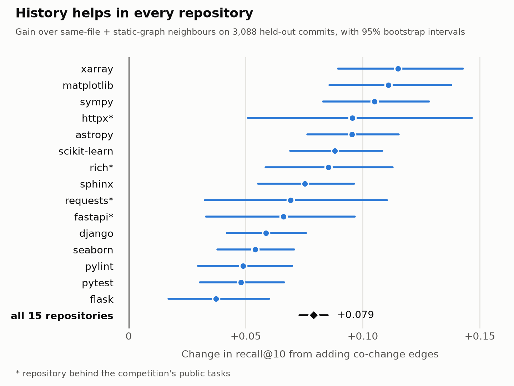

# What Else Must Change? Edit History as a Missing Edge Type in Code Graphs

### Graph neighbourhoods do not help a coding agent find a fix, but they help it finish one, and git history adds what the call graph cannot see

## Abstract

Code graphs give software-engineering agents structure: who calls whom, what contains what. We ask when that structure actually helps, and whether a second, cheaper source of edges, the repository's own edit history, adds anything to it. We mine symbol-level *co-change* edges (two functions edited in the same past commit) from git history with a time-respecting protocol and evaluate them on SWE-bench Verified (485 issues, 12 repositories) and on 3,088 held-out commits from 15 repositories. Three results stand out. First, a negative one: expanding text-retrieval hits with *any* neighbourhood (same file, static graph, or history) at equal weight lowers issue-to-function recall@10 by about 14 points, because 70% of fixes edit one function. Second, once one edited function is known, neighbourhoods become useful, and history is the strongest single signal: adding co-change edges to same-file and static-graph neighbours raises recall@10 by 7.9 points (95% CI 7.3 to 8.5), with a positive interval in all 15 repositories. Third, about half of that gain survives a small model: when Gemma 4 E4B (4-bit, on a laptop) picks which candidates to edit, recall rises by 2.2 points (95% CI 0.0 to 4.6), limited by how few candidates it picks. We release the miner, the edges, and a dependency-free tool that tells an agent which functions usually change with its current diff.

## 1. Introduction

A small model running on a laptop cannot read a whole repository, so agents built on such models lean on tools that narrow the search: text retrieval, embeddings, and code graphs. The Gemma 4 Developer Agent competition gives agents graph and embedding tools for this purpose (`get_code_neighbors`, `get_code_subgraph`, `search_similar_code`), backed by call and dependency graphs. Such tools are usually evaluated as a way to *find* the code to change.

This paper starts from a different observation. In `httpx`, the method `Client.send` and its twin `AsyncClient.send` have been edited in the same commit 14 times. Neither calls the other. In our static graph the twin is two hops away, ranked 68th of 74 neighbours; by position in the file it is 57th of 80. History ranks it first. An agent that fixes one and stops has produced half a patch, and the structure of the code gives it little reason to look further.

Software-evolution research has known this for two decades under the names *logical coupling* and *co-change* [1, 2, 3]. It has not, to our knowledge, been evaluated as an edge type alongside the static graphs that coding agents now use. We do that here and ask three questions.

- **RQ1.** When do graph neighbourhoods help: when locating a fix from the issue text, or when completing a fix that has been started?
- **RQ2.** Do co-change edges add information beyond same-file proximity and static-graph neighbours?
- **RQ3.** Does a small local model (Gemma 4 E4B, 4-bit) make better selections when its candidates include history?

**Contributions.**

1. A negative result with a diagnosis: neighbourhood expansion of retrieval hits hurts issue-to-function localization unless it is weighted down to near zero, for every neighbourhood type we tried (Section 4.1).
2. A positive result in the complementary setting, *edit completion*: co-change is the best single neighbourhood signal and improves every combination we tested, across 15 repositories (Sections 4.2 and 4.3).
3. A measurement of how much of that gain reaches a small local model: Gemma 4 E4B passes on about half, picks better than the ranked list at equal size, but picks too few to match the list's top five (Section 4.4).
4. A resource: a standard-library-only miner and agent tool, plus 249,739 co-change edges over 61,238 symbols for 15 repositories, exported in the node-link schema of the competition's code graphs (Section 5).

## 2. Co-change edges

**Definition.** A *symbol* is a top-level function, a class, or a method, the same granularity as the nodes of the competition's code graphs. For a repository snapshot at commit *c*, the co-change weight of symbols *a* and *b* is the number of commits among the ancestors of *c* that edit both. An edge exists when the weight is at least one; the released edge files keep weight two or more.

**Mining.** We read `git log -p -U0` once. For every changed hunk we parse the old and the new version of the file with Python's `ast` and attribute each changed line to the innermost enclosing symbol. Files Python 3 cannot parse (old Python 2 history) fall back to an indentation scanner. Merge commits are skipped, and commits that edit more than 30 symbols are ignored as evidence, the usual guard against sweeping refactors [2]. Test files are excluded from all results in this paper.

**No leakage by construction.** Every query passes the set of commits it may see, namely the ancestors of the snapshot being queried. A fix can never contribute evidence about itself.

**Cost.** The 15 repositories in this paper contain 164,792 commits that change Python symbols. Mining the 12 largest in parallel took 9.5 minutes of wall-clock time on an Apple M4 laptop. `httpx` takes 9 seconds; later queries take 0.2 seconds from a cache.

## 3. Experimental setup

**Data.** (i) SWE-bench Verified [4, 5]: 500 human-validated issues from 12 Python repositories. We derive gold labels by mapping each reference patch onto the symbols of the *pre-fix* snapshot (the code an agent sees). 485 tasks edit at least one existing symbol; the other 15 only add new top-level code and are dropped. (ii) Held-out history: for each of 15 repositories (the 12 above plus the competition's `fastapi`, `rich` and `httpx`), the final 25% of commits that edit 2 to 15 symbols, at most 300 per repository, evenly spaced.

**Static graph baseline.** We did not use the competition's released graphs. Our static graph is a reimplementation with the same node granularity: class-contains-method edges, inheritance edges, and call edges resolved by name (skipped when more than five symbols share the name). Neighbour lists are one-hop then two-hop, low-degree first. Section 7 returns to this limitation.

**Signals.** `issue`: BM25 [6] over every symbol's source text with identifier-aware tokenization. `samefile`: symbols in the seed's file, nearest first. `static`: static-graph neighbours of the seed. `cochange`: symbols ranked by co-change weight with the seed. `hot`: symbols ranked by how often they were edited in the past, a control for "busy code gets fixed again". Lists are combined with reciprocal rank fusion (RRF, k=60) [7]. The fusion constant, the 30-symbol cap and list lengths were fixed before the first run.

**Metrics.** Recall@k over gold symbols and MRR. Differences are reported with 95% paired bootstrap intervals that resample whole tasks or commits (5,000 to 10,000 resamples).

## 4. Results

### 4.1 Locating a fix: neighbourhoods do not help (RQ1)

The input is the issue text only. BM25 produces a ranking; its top 10 hits act as seeds, and the seeds' neighbours are fused into the ranking.

| Ranking (485 tasks) | R@1 | R@10 | MRR |
|---|---|---|---|
| BM25 over symbols | 0.228 | 0.543 | 0.394 |
| + same-file neighbours | 0.072 | 0.408 | 0.224 |
| + static-graph neighbours | 0.086 | 0.404 | 0.240 |
| + co-change neighbours | 0.097 | 0.399 | 0.250 |
| + hot-spot prior | 0.030 | 0.259 | 0.124 |
| + static, weight 0.1 | 0.174 | 0.555 | 0.360 |
| + co-change, weight 0.1 | 0.173 | 0.548 | 0.358 |

At equal weight every neighbourhood costs 13 to 14 points of recall@10 (co-change: -0.144, CI -0.181 to -0.109). Weighted down to 0.1, the best of the four weights we tried (0.05 to 0.5), the change in recall@10 is within noise for co-change (+0.005, CI -0.005 to +0.016) and same-file, and marginal for static (+0.012, CI -0.001 to +0.026), while recall@1 still falls by five points. The hot-spot prior is worst by far: past edit frequency is not evidence about *this* issue.

The reason is in the label distribution. 340 of the 485 fixes (70%) edit exactly one symbol. For those, a neighbour of a retrieval hit can only be a distractor. Restricting to the 145 multi-symbol fixes, equal-weight expansion is neutral rather than harmful (co-change: -0.027, CI -0.065 to +0.009). Neighbourhoods answer the question "what else?", and during localization that question has not been asked yet.

### 4.2 Completing a fix: history is the best single signal (RQ1, RQ2)

Now suppose one edited symbol is known, as it is once an agent has made its first edit. For each of the 145 multi-symbol fixes, each gold symbol takes a turn as the seed (606 seeds) and each signal ranks the other gold symbols. The issue text is still available.

| Signal for finding the remaining edits | R@5 | R@10 | MRR |
|---|---|---|---|
| static | 0.207 | 0.279 | 0.318 |
| samefile | 0.197 | 0.284 | 0.354 |
| issue (BM25) | 0.225 | 0.297 | 0.377 |
| **cochange** | **0.256** | **0.341** | **0.446** |
| samefile + static | 0.225 | 0.329 | 0.392 |
| samefile + static + cochange | 0.307 | 0.418 | 0.487 |
| issue + samefile + static | 0.331 | 0.451 | 0.517 |
| **issue + samefile + static + cochange** | **0.382** | **0.495** | **0.562** |

Co-change alone beats the static graph (+0.062, CI +0.008 to +0.121) and same-file proximity (+0.057, CI +0.005 to +0.115). Added to same-file and static neighbours it contributes +0.090 (CI +0.061 to +0.125); added on top of the issue text as well, +0.043 (CI +0.022 to +0.069). The gain holds when the benchmark is split into Django (+0.070) and the other eleven repositories (+0.027, CI +0.002 to +0.056).

The same neighbourhoods that hurt in Section 4.1 help here: fusing the issue ranking with any of them improves recall@10 by 11 to 14 points. The difference between the two settings is only whether the seed is a real edit or a retrieval guess.

### 4.3 Generality: 15 repositories, 3,088 held-out commits (RQ2)

To test completion at scale and outside the benchmark, we replay real history: 3,088 held-out commits, 12,952 seeds, no issue text.

| Signal | R@5 | R@10 | MRR |
|---|---|---|---|
| static | 0.206 | 0.285 | 0.340 |
| samefile | 0.246 | 0.350 | 0.375 |
| cochange | 0.274 | 0.362 | 0.431 |
| samefile + static | 0.263 | 0.378 | 0.396 |
| **samefile + static + cochange** | **0.331** | **0.457** | **0.479** |

Adding co-change to same-file and static neighbours gives +0.079 recall@10 (CI +0.073 to +0.085). The per-repository gain ranges from +0.037 (`flask`) to +0.115 (`xarray`), and the interval excludes zero in all 15 (Figure 1), including the four repositories behind the competition's public tasks. A one-year recency half-life changes recall@10 by less than half a point, so we keep plain counts.



**History ranks more than it reaches.** Of 66,892 co-edited symbol pairs, 55% are in the same file, 54% are within two static hops, and 43% have been co-edited before. Only 4.9% are reachable through history and through neither of the others; 26% are reachable by nothing. The gain therefore comes mostly from ordering. A function's static neighbourhood is large and unranked by relevance to change, and history says which of those neighbours actually move together.

### 4.4 Does a small model benefit? Gemma 4 E4B on a laptop (RQ3)

We give Gemma 4 E4B (4-bit MLX build, greedy decoding, thinking disabled) the issue, the source of one edited symbol, and ten candidates in ranked order with their first two lines, and ask which candidates must also be edited (at most five). In condition A the candidates come from issue + samefile + static; in condition B from the same fusion with cochange added. Nothing else differs: 606 seeds, 1,212 calls, about 3.5 seconds each on an Apple M4 laptop.

| | A: no history | B: + history | B − A (95% CI) |
|---|---|---|---|
| Gold in the ten candidates | 0.451 | 0.495 | +0.043 (Section 4.2) |
| Recall of the list's top 5, no model | 0.331 | 0.382 | +0.050 (+0.024, +0.081) |
| **Recall of Gemma's picks** | 0.205 | 0.227 | +0.022 (0.000, +0.046) |

The answer to RQ3 is a qualified yes: recall of the model's picks rises by 2.2 points, with an interval that touches zero. The effect is clear on Django (+0.044, CI +0.005 to +0.088) and absent on the other eleven repositories (+0.008, CI −0.016 to +0.035). In both conditions the model selects 41% of the gold candidates it is shown, so about half of the list's gain passes through.

The model does add judgment: its picks recall more than the same number of candidates taken from the top of the list (+0.045 in A, +0.031 in B, both intervals above zero). But it is conservative, picking two candidates on average and none in 19% of calls, so its recall stays 13 to 15 points below simply acting on the list's top five. For a model of this size, a longer menu to prune loses much of what history adds; a short ranked checklist to act on, which is what the `check` command in Section 5 prints, keeps it.

## 5. Resource: `cochange`

We release three things under Apache 2.0 at https://github.com/mritopper/cochange.

**A miner and library** (`mine_history.py`, `cochange.py`): Python standard library only, about 500 lines with the tool, works on any git repository with Python sources.

**Edge files** for 15 repositories: 249,739 co-change edges (weight two or more) over 61,238 symbols, in node-link JSON with the same `nodes[].id` convention (fully qualified symbol path) and `edges[].source/target/type` fields as the competition's code graphs, with `type: "co_changed"` and an integer `weight`.

**An agent tool** (`cochange_tool.py`) with three commands. `neighbors SYMBOL` lists co-change neighbours with evidence counts. `export` writes the edge file. `check` reads the agent's *uncommitted diff*, maps it to symbols, and lists symbols that history says change with them but that the diff has not touched:

```
$ cochange_tool.py check
Your diff edits 1 symbol(s): httpx._client.Client.send
Historically edited in the same commits but not in your diff:
  httpx._client.AsyncClient.send      (14x with send)
  httpx._client.AsyncClient.request   (6x with send)
  httpx._client.Client.request        (6x with send)
```

The tool is a single script with two sibling modules, so it fits the competition's skill-script format. The competition's sandbox snapshots are git repositories frozen at `base_commit` with forward history removed; where past history is kept, that is the visibility rule our protocol uses. Section 4 says when to call the tool: after the first edit, on the agent's own diff, not during the initial search.

## 6. Related work

**Co-change in software evolution.** Gall et al. [1] introduced logical coupling from release histories; Zimmermann et al. [2] and Ying et al. [3] mined version histories to recommend further changes to developers; Kagdi et al. [8] combined logical with conceptual coupling for impact analysis. We reuse the idea at symbol granularity and test it against the tools a modern agent already has.

**Graphs and localization for coding agents.** SWE-agent [9], AutoCodeRover [10] and Agentless [11] localize with search and structure-aware tools; RepoGraph [12] and LocAgent [13] give agents explicit code graphs. These works evaluate graphs as a localization aid. Our Section 4.1 is a caution for that use and Section 4.2 a case for a different one.

**History for agents.** Wang et al. [14] add a memory of past commits and LLM-written summaries of frequently edited files to LocAgent. Their signal is retrieved text consumed by a large model; ours is a typed edge with no model in the loop, and our hot-spot control suggests that edit frequency alone is not what carries the benefit. Practitioner tools that mine file-level co-change also exist; we are not aware of one evaluated against a static graph at symbol level.

**LLMs and graphs.** Fatemi et al. [15] and Perozzi et al. [16] study how graph structure should be presented to language models. Our finding is upstream of encoding: which edges are worth presenting, and at which step of the task.

## 7. Limitations

- **The static graph is ours.** We did not evaluate on the competition's released graphs or its 129 tasks. A more precise call graph could narrow the gap in Sections 4.2 and 4.3. The edge export uses the same schema so that this comparison is one merge away.
- **Oracle seeds.** Completion experiments assume one correct edit is known. An agent's first edit can be wrong, and co-change neighbours of a wrong edit are distractors, as Section 4.1 shows.
- **No end-to-end patches.** We measure retrieval and one-shot selection by one small model, not resolved issues. The Gemma effect is borderline overall and carried by Django.
- **Lexical issue baseline.** `issue` is BM25; a dense retriever would raise that baseline.
- **History-rich repositories.** All 15 repositories are mature. Co-change needs history; a new repository has none. The private repositories of the competition's test set may differ.
- **Python only**, though nothing in the method depends on the language beyond the parser.

## 8. Conclusion

A code graph's neighbourhood is an answer to "what else?", and that question is worth asking only after an agent knows something true about the fix. Asked then, edit history answers it better than the call graph does and combines well with it. For small local models, whose context is the scarce resource, a short ranked list of functions that have moved together before is a cheap thing to offer at the right moment.

## References

[1] H. Gall, K. Hajek, M. Jazayeri. Detection of Logical Coupling Based on Product Release History. ICSM 1998.
[2] T. Zimmermann, P. Weißgerber, S. Diehl, A. Zeller. Mining Version Histories to Guide Software Changes. ICSE 2004.
[3] A. Ying, G. Murphy, R. Ng, M. Chu-Carroll. Predicting Source Code Changes by Mining Change History. IEEE TSE 30(9), 2004.
[4] C. Jimenez et al. SWE-bench: Can Language Models Resolve Real-World GitHub Issues? ICLR 2024.
[5] N. Chowdhury et al. Introducing SWE-bench Verified. OpenAI, 2024.
[6] S. Robertson, H. Zaragoza. The Probabilistic Relevance Framework: BM25 and Beyond. Foundations and Trends in IR, 2009.
[7] G. Cormack, C. Clarke, S. Büttcher. Reciprocal Rank Fusion Outperforms Condorcet and Individual Rank Learning Methods. SIGIR 2009.
[8] H. Kagdi, M. Gethers, D. Poshyvanyk. Integrating Conceptual and Logical Couplings for Change Impact Analysis in Software. Empirical Software Engineering 18, 2013.
[9] J. Yang et al. SWE-agent: Agent-Computer Interfaces Enable Automated Software Engineering. NeurIPS 2024.
[10] Y. Zhang et al. AutoCodeRover: Autonomous Program Improvement. ISSTA 2024.
[11] C. Xia et al. Agentless: Demystifying LLM-based Software Engineering Agents. arXiv:2407.01489, 2024.
[12] S. Ouyang et al. RepoGraph: Enhancing AI Software Engineering with Repository-level Code Graph. ICLR 2025.
[13] Z. Chen et al. LocAgent: Graph-Guided LLM Agents for Code Localization. ACL 2025.
[14] B. Wang et al. Improving Code Localization with Repository Memory. arXiv:2510.01003, 2025.
[15] B. Fatemi, J. Halcrow, B. Perozzi. Talk like a Graph: Encoding Graphs for Large Language Models. ICLR 2024.
[16] B. Perozzi et al. Let Your Graph Do the Talking: Encoding Structured Data for LLMs. arXiv:2402.05862, 2024.
[17] E. Markowitz et al. Google - The Gemma 4 Developer Agent Paper Track. Kaggle, 2026.
